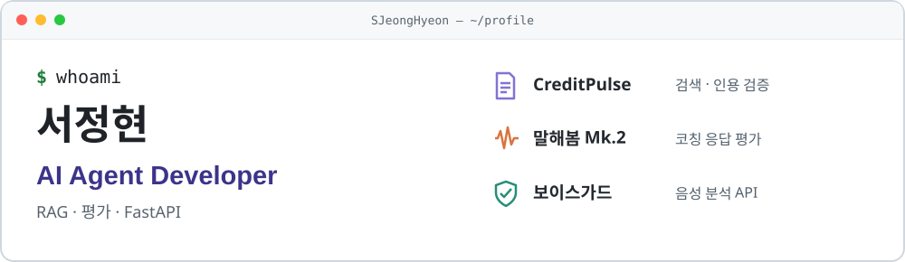
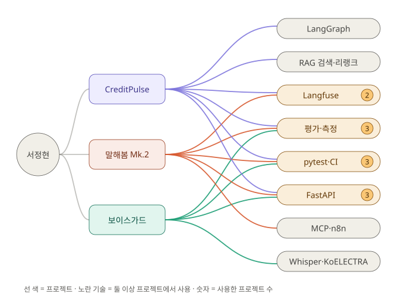

<picture>
  <source media="(prefers-color-scheme: dark)" srcset="assets/profile-seven-dark.svg">
  
</picture>

  
  
  

**서정현**입니다. AI 서비스를 만들 때는 ‘이 답을 믿을 근거가 있을까?’, ‘사용자가 작업 도중에 멈추고 싶으면 어떻게 할까?’ 같은 질문에서 출발합니다.

## 🗂️ 세 프로젝트에서 맡은 일

| 프로젝트 | 해결하는 문제 · 개인 기여 · 확인할 곳 |
| :-- | :-- |
| [**CreditPulse**](https://github.com/SJeongHyeon/credit-pulse) | 사업보고서에서 근거를 찾아 기업여신 심사 초안을 만들고 사람 승인 후 저장합니다. LangGraph 흐름, 인용 검증, 승인 처리와 검색 평가를 맡았습니다. 심사역의 승인을 기다리는 동안 **에이전트 상태를 저장해 승인 뒤 이어서 실행**하도록 구현했습니다. [기여 근거](https://github.com/SJeongHyeon/credit-pulse/blob/main/CONTRIBUTIONS.md) · [시연](https://github.com/SJeongHyeon/credit-pulse/blob/main/docs/demo/creditpulse_demo.mp4) |
| [**말해봄 Mk.2**](https://github.com/SJeongHyeon/malhaebom-mk2) | 한국어 면접 답변을 분석하고 코칭합니다. 모델·프롬프트 평가 도구, 관측, 테스트와 화면에 기여했습니다. **코칭 응답이 정해진 형식을 지키는지 검사하는 평가 도구**를 만들었습니다. 응답이 중간에 잘린 경우를 분류하고, 자동 판정이 어긋난 사례를 사람이 검토할 양식을 추가했습니다. [기여 근거](https://github.com/SJeongHyeon/malhaebom-mk2/blob/main/CONTRIBUTIONS.md) |
| [**보이스가드**](https://github.com/SJeongHyeon/voiceguard) | 통화 녹음에서 보이스피싱 의심 구간을 알려줍니다. FastAPI 백엔드, 비동기 작업과 모델 연동을 맡았습니다. FastAPI에서 **분석 상태를 조회하고 실행 중인 작업을 취소**할 수 있도록 API를 분석 작업에 연결했습니다. 임시 음성 데이터 정리도 맡았습니다. [기여 근거](https://github.com/SJeongHyeon/voiceguard/blob/main/CONTRIBUTIONS.md) · [시연](https://github.com/SJeongHyeon/voiceguard/blob/main/docs/demo/voiceguard_demo.mp4) |

## 🔧 프로젝트별 상세 기여

팀 프로젝트에서 **제가 직접 만든 부분**만 적었습니다. PR 번호는 비공개 원본의 번호이고, 코드 위치는 공개 사본의 경로입니다.

### CreditPulse · LangGraph 에이전트와 평가

| 기여 | 무엇을 어떻게 했나 | 확인할 곳 |
| :-- | :-- | :-- |
| **프롬프트 인젝션 방어** (#169) | 질문에 지시문을 숨겨 넣는 공격을 **LLM을 부르지 않는 코드 규칙**으로 막습니다. 전각·제로폭 문자와 비슷하게 생긴 외국 문자를 정규화하고, 문구 단위로 점수를 매겨 **대화 전체의 누적 위험도**를 봅니다(턴마다 0.7배로 줄고, 60 이상이면서 이번 질문에 위험 신호가 있으면 차단하며, 차단된 질문을 표현만 바꿔 다시 보내면 가중). 응답이 나가기 직전에는 키·접속 문자열·시스템 프롬프트 조각이 실려 나가는지 한 번 더 검사합니다. 방어 단위 시험 39건이 공개 사본에서 통과합니다. 공격 차단률 같은 효과 수치는 측정하지 않았습니다. | [`injection_guard.py`](https://github.com/SJeongHyeon/credit-pulse/blob/main/backend/graph/injection_guard.py) · [`output_guard.py`](https://github.com/SJeongHyeon/credit-pulse/blob/main/backend/graph/output_guard.py) · [`test_injection_guard.py`](https://github.com/SJeongHyeon/credit-pulse/blob/main/tests/test_injection_guard.py) · [설계 문서](https://github.com/SJeongHyeon/credit-pulse/blob/main/docs/specs/multi-turn-injection-defense.md) |
| 방어가 만든 부작용 | 작성기 지시문에 인젝션 방어 문장을 더했더니 고정 평가에서 정답 근거 인용이 24건에서 23건으로 줄어(같은 5번 문항, 3회 모두), 그 지시문 문장을 되돌렸습니다. | [EVAL_REPORT.md 4-50·4-51](https://github.com/SJeongHyeon/credit-pulse/blob/main/EVAL_REPORT.md) |
| **승인 대기와 재개** (#89) | 사람 승인 단계에서 그래프를 멈추고 `thread_id`로 상태를 저장해, 승인 뒤 이어서 실행합니다. | [`build.py`](https://github.com/SJeongHyeon/credit-pulse/blob/main/backend/graph/build.py) |
| **인용 검증기** (#80) | 초안의 인용과 숫자가 실제 근거 청크와 맞는지 검사합니다. | [`verifier.py`](https://github.com/SJeongHyeon/credit-pulse/blob/main/backend/graph/verifier.py) |
| **비관련 질문 거절** (#58, #79) | 공시에 없는 항목이나 보고서에 없는 반기보고서 요청은 지어내지 않고 사유 코드와 함께 거절합니다. | [`refusal.py`](https://github.com/SJeongHyeon/credit-pulse/blob/main/backend/graph/refusal.py) |
| **사용자별 규칙 메모리** (#98, #114) | 심사역이 승인한 규칙을 저장하고, 다음 질문에서 의미가 비슷한 규칙을 불러옵니다. | [`memory.py`](https://github.com/SJeongHyeon/credit-pulse/blob/main/backend/memory.py) |
| **리랭커 측정** (#54) | 리랭커 후보 수와 배치 크기에 따른 지연을 측정했습니다. | [`rerank.py`](https://github.com/SJeongHyeon/credit-pulse/blob/main/backend/rag/rerank.py) |
| **API·가입** (#115, #149) | 심사 건 질의·승인 API와 Gmail 인증코드 회원가입을 구현했습니다. | [`reviews.py`](https://github.com/SJeongHyeon/credit-pulse/blob/main/backend/api/reviews.py) · [`auth.py`](https://github.com/SJeongHyeon/credit-pulse/blob/main/backend/auth.py) |
| **거절 시 참고 뉴스** (#203) | 거절할 때 붙이는 참고 뉴스에서 다른 회사 이름이 섞인 결과를 사후 필터로 걸러냅니다. | [`news_search.py`](https://github.com/SJeongHyeon/credit-pulse/blob/main/backend/services/news_search.py) |
| **검색 실험** (#235, #239) | 문서 구조 그래프 검색(기본 꺼짐)과 목차 어휘 번역(미채택)을 평가셋으로 재서 결정했습니다. | [사례 연구](https://github.com/SJeongHyeon/credit-pulse/blob/main/docs/case-studies/term-bridge-rejected.md) |

### 말해봄 Mk.2 · 모델 평가와 검증 도구

| 기여 | 무엇을 어떻게 했나 | 확인할 곳 |
| :-- | :-- | :-- |
| **구조화 출력 평가 실행기** (#14, #16, #19, #43, #45) | 코칭 응답이 JSON Schema 형식을 지키는지 모델·프롬프트 후보마다 자동 채점합니다. | [`evals/`](https://github.com/SJeongHyeon/malhaebom-mk2/blob/main/evals) |
| **출력 절단 분류와 사람 검토 양식** (#156, #158, #160, #161) | 응답이 중간에 잘린 경우를 원인별로 분류하고, 4096-token 출력 계약을 다시 검증했습니다. 자동 판정이 어긋난 사례는 사람이 검토할 양식으로 뽑습니다. | [`evals/`](https://github.com/SJeongHyeon/malhaebom-mk2/blob/main/evals) |
| **범용 응답 대 서비스 응답 비교** (#67, #68) | 같은 질문을 범용 모델 응답과 말해봄 응답으로 나란히 비교하는 실행기입니다. | [`generic_vs_malhaebom.py`](https://github.com/SJeongHyeon/malhaebom-mk2/blob/main/evals/generic_vs_malhaebom.py) |
| **공고 적합성 비교** (#50, #63) | GitHub 근거 기반 공고 적합성 제안과 출력 계약 강제를 구현했습니다. | [`run_github_job_fit_comparison.py`](https://github.com/SJeongHyeon/malhaebom-mk2/blob/main/evals/run_github_job_fit_comparison.py) |
| **판단 기준·Prompt·Skill** (#65, #84, #85, #86, #110) | 원인 판단을 관찰 신호와 추론으로 나누고, README 근거 추출·공고 요구사항 추출 Skill과 Prompt를 분리했습니다. | [`skills/`](https://github.com/SJeongHyeon/malhaebom-mk2/blob/main/skills) |
| **Langfuse 관측** (#107, #108) | provider 호출의 시작·종료와 지연 시간 기록을 바로잡았습니다. | [`coaching_observability.py`](https://github.com/SJeongHyeon/malhaebom-mk2/blob/main/backend/app/services/coaching_observability.py) |
| **응답 계약·장애 검증** (#113, #116, #117, #122, #142, #172) | 인증된 Agent 응답 계약, MCP 장애 응답, 코칭 결과의 DB 저장을 검증하는 도구를 추가했습니다. | [`backend/tests/`](https://github.com/SJeongHyeon/malhaebom-mk2/blob/main/backend/tests) |
| **CI와 재현** (#44, #124, #133, #135, #144, #145) | Product CI에 pytest를 추가하고, 새 복제본의 Docker Compose 실행을 검증했으며, n8n 모의 코칭 워크플로를 만들었습니다. | [`product-ci.yml`](https://github.com/SJeongHyeon/malhaebom-mk2/blob/main/.github/workflows/product-ci.yml) · [재현 점검](https://github.com/SJeongHyeon/malhaebom-mk2/blob/main/docs/evidence/clean-compose-reproduction-20261010.md) |
| **화면** (#211) | 시작 화면과 라이트·다크 테마 전환을 추가했습니다. 발표용 PPT도 제작했습니다(발표는 담당하지 않음). | [`frontend/`](https://github.com/SJeongHyeon/malhaebom-mk2/blob/main/frontend) |

말해봄의 코드 위치는 PR별 변경 파일을 일일이 대조하지 않고 이름과 역할이 맞는 공개 사본의 경로를 적었습니다.

### 보이스가드 · FastAPI 백엔드

| 기여 | 무엇을 어떻게 했나 | 확인할 곳 |
| :-- | :-- | :-- |
| **API 계약과 공통 오류** (#10~#13) | 백엔드 API 명세를 쓰고, 음성 파일 업로드 검증과 공통 오류 응답을 구현했습니다. | [`backend-api.md`](https://github.com/SJeongHyeon/voiceguard/blob/main/docs/specs/backend-api.md) · [`app/api/`](https://github.com/SJeongHyeon/voiceguard/blob/main/app/api) |
| **비동기 작업과 취소** (#15~#18, #21, #27) | 분석 작업 저장소, 상태 조회, **실행 중인 작업 취소**, 끝난 뒤 임시 음성 데이터 정리를 연결했습니다. | [`app/jobs/`](https://github.com/SJeongHyeon/voiceguard/blob/main/app/jobs) |
| **요청 제어** (#19) | 같은 작업 중복 실행 잠금, 요청 횟수 제한을 넣었고, 접속 IP는 HMAC-SHA256으로 해시해 다룹니다. | [`request_controls.py`](https://github.com/SJeongHyeon/voiceguard/blob/main/app/core/request_controls.py) |
| **모델 연동** (#33, #34, #35, #37, #39, #43, #44) | KoELECTRA 분류기와 Whisper(LoRA 포함) 음성 인식을 서비스에 연결하고, 음성 바이트 디코딩과 추론 시간 제한을 고쳤습니다. | [`app/analysis/`](https://github.com/SJeongHyeon/voiceguard/blob/main/app/analysis) |
| **분석 파이프라인** (#47, #49, #50, #51, #58) | 6단계 진행 상태를 보여 주고, 전사문 정규화 뒤 청크 단위로 분류하며, 전사와 분류를 큐로 이어 주는 스트리밍 파이프라인을 만들었습니다. | [`app/analysis/`](https://github.com/SJeongHyeon/voiceguard/blob/main/app/analysis) |
| **검증 도구** (#36, #56) | 업로드부터 결과·실패·취소·정리까지의 E2E 시험과, 라벨 데이터로 혼동행렬과 Recall·FPR 등을 계산하는 평가 도구를 추가했습니다. | [E2E 시험](https://github.com/SJeongHyeon/voiceguard/blob/main/tests/api/test_analysis_pipeline_e2e.py) · [`model_evaluation.py`](https://github.com/SJeongHyeon/voiceguard/blob/main/tools/model_evaluation.py) |
| **컨테이너 설정** (#20) | 컨테이너 실행 구성을 작성했습니다. | [`Dockerfile`](https://github.com/SJeongHyeon/voiceguard/blob/main/Dockerfile) |
| **ONNX INT8 도입과 롤백** (#57, #62) | 분류기를 ONNX INT8로 바꿨다가 위험 점수가 0.99 이상으로 포화돼 PyTorch로 되돌렸습니다. 원인은 확정하지 못했습니다. | [사례 연구](https://github.com/SJeongHyeon/voiceguard/blob/main/docs/case-studies/onnx-int8-rollback.md) |

팀 모델의 학습과 성능 수치는 팀의 결과이고, 위 표는 제가 맡은 서비스 구현과 검증 부분입니다. 비공개 원본의 PR 번호별 내용은 각 저장소의 `CONTRIBUTIONS.md`에 있습니다.

## 📈 Impact · 검증한 결과

아래 수치는 **팀 프로젝트의 측정 결과**이며 개인 기여와 구분합니다. 결과의 조건과 한계를 함께 적었습니다.

| 확인한 결과 | 범위와 해석 |
| :-- | :-- |
| **CreditPulse · 정답 근거 인용 23/25, 오답 근거 0/25** | 동결 v2 관련 25문항, 1회 실행. 답변 숫자까지 정확하다는 뜻은 아닙니다. [측정 근거](https://github.com/SJeongHyeon/credit-pulse#측정-결과) |
| **말해봄 · 출력 형식 90/90** | 합성 입력 30건 × 3회 자동 평가. 종합 통과 57/90이며 최신 운영 구성의 사람 평가는 없습니다. [측정 근거](https://github.com/SJeongHyeon/malhaebom-mk2#측정-결과) |
| **보이스가드 · Recall 98.98%** | 팀 모델 평가 499개 샘플. 오탐률 48.84%, 독립 시험셋 확인 전. [측정 근거](https://github.com/SJeongHyeon/voiceguard#실험-결과) |

### 🔎 실험에서 내린 결정

### 검색이 한 건 더 성공했는데도 기능을 켜지 않은 이유

문서 그래프를 추가하자 일상어 질문 23개 중 상위 10개 검색 결과에서 근거를 찾은 질문이 **19개에서 20개**로 늘었습니다. 그런데 별도의 고정 평가 50문항에서는 정답 근거를 인용한 응답이 24건에서 23건으로 줄고, 오답 근거 인용이 0건에서 1건으로 늘었습니다. 각 설정을 한 번씩 비교한 결과를 보고 그래프 검색을 기본값에서 꺼 두었습니다. [실험 기록](https://github.com/SJeongHyeon/credit-pulse/blob/main/docs/evidence/graph_retrieval_2026-11-13.md)

### 채택하지 않은 실험과 실패 사례

- **미채택 · CreditPulse**: [목차 어휘 번역](https://github.com/SJeongHyeon/credit-pulse/blob/main/docs/case-studies/term-bridge-rejected.md). 첫 검색 Hit@10 20/23 → 22/23이지만 검색 p50 1.73초 → 4.00초로 사전 한도(+1.5초)를 넘어 미채택했습니다.
- **승격 보류 · 말해봄**: [Prompt v5 후보](https://github.com/SJeongHyeon/malhaebom-mk2/blob/main/docs/case-studies/prompt-v4-v5-candidate.md). 비용은 약 13.3% 줄었지만 종합 자동 통과가 22/30 → 20/30으로 줄어 승격을 보류했습니다.
- **임시 롤백 · 보이스가드**: [ONNX INT8 분류기](https://github.com/SJeongHyeon/voiceguard/blob/main/docs/case-studies/onnx-int8-rollback.md). 점수가 0.99 이상으로 포화되는 현상이 관찰돼 PyTorch로 되돌렸고, 원인은 확정하지 못했으며 비교 결과 기록도 없습니다.

## 🛠️ 기술 스택

분야별 기술 배지 펼치기

세 팀 프로젝트에서 실제로 사용한 기술만 적었습니다. 모델과 서비스의 사용·연동 경험은 직접 개발한 기능과 구분합니다.

**AI / Agent · 검색**  

**Backend · Data**  

**평가 · 품질**  

**음성 · NLP 연동**  

### <samp>🕸 ~/graph</samp> 프로젝트와 기술의 관계

<picture>
  <source media="(prefers-color-scheme: dark)" srcset="assets/relation-graph-dark.svg">
  
</picture>

직접 그린 관계도이며([생성 스크립트](assets/make_relation_graph.py)) 실제로 쓴 기술만 넣었습니다. 실선은 근거를 확인한 관계, 점선은 구현이 아니라 검증 근거만 있는 관계입니다.

<b>이 관계도의 근거</b>

숫자는 비공개 원본의 PR 번호이며, 각 저장소의 `CONTRIBUTIONS.md`에서 내용을 확인할 수 있습니다.

| 기술 | CreditPulse | 말해봄 | 보이스가드 |
| --- | --- | --- | --- |
| FastAPI | 심사 API·로그인 | 응답 계약 검증 #113·#116(점선) | #11·#12·#13·#15·#16·#17·#18·#19·#27 |
| 평가·측정 | 평가셋·사전 등록·`EVAL_REPORT.md` | 평가 실행기 #14·#19·#43·#45 | 분류 평가 도구 #56 |
| pytest | 키 없이 1626 통과(사본 재실행) | Product CI에 pytest 추가 #145 | E2E #36, 요청 제어 #19, 평가 도구 #56 |
| CI | Actions 통과(2026-11-19, `596a670`) | Actions 통과(2026-11-19, `e00b408`) | 없음 |
| Langfuse | `backend/services/tracing.py` | 지연 계측 #107·#108 | — |
| LangGraph | `backend/graph/` | — | — |
| RAG 검색·리랭크 | `EVAL_REPORT.md` 3장 | — | — |
| MCP·n8n | — | #142·#44 | — |
| Whisper·KoELECTRA | — | — | #33·#34·#37 |

### <samp>📝 ~/how</samp> 어떻게 일하나

- **미채택도 기록합니다.** CreditPulse의 [평가 리포트](https://github.com/SJeongHyeon/credit-pulse/blob/main/EVAL_REPORT.md)에는 제목에 미채택이 표기된 절이 22개(순수 미채택 19개, 일부 채택·보류 3개) 있습니다. 측정 전에 기준을 먼저 등록했고, 결과가 기준에 못 미치면 효과가 있어도 되돌렸습니다.
- **한계를 먼저 적습니다.** 표의 수치마다 표본 수, 조건, 사람 평가 여부를 함께 적었습니다.
- **재현할 수 있게 둡니다.** 세 저장소 모두 API 키 없이 돌리는 시험 결과와 명령을 README에 남겼습니다. CreditPulse와 말해봄은 GitHub Actions에서도 통과했고(2026-11-19 수동 실행), 보이스가드는 CI가 없어 시험 4건 실패의 원인을 기록했습니다.

<b>그 밖의 프로젝트</b>

### TicketPilot · 개인 프로젝트

Windows에서 예매 시작 시각을 KST 기준으로 관리하는 Python 데스크톱 도우미입니다.

- CustomTkinter GUI, 날짜·시간 선택, 카운트다운과 사전 알림, 설정 저장
- URL 검증, 예약 취소·중복 방지, 로컬 테스트 서버와 자동 테스트
- 실제 예매 사이트에서는 사용자가 직접 예매합니다. 자동 클릭 검증은 로컬 테스트 페이지에서만 수행합니다.
- Windows 실행 파일 빌드 구성과 사용자 설정 저장 위치 처리까지 구현했습니다.
- [공개용 코드 저장소](https://github.com/SJeongHyeon/ticketpilot-public)

프로젝트별 시연 및 기여 집계 기준

커밋·PR은 비공개 원본에서 2026-11-19에 센 값이며 기여의 크기를 뜻하지 않습니다. CreditPulse 커밋 203건·PR 65건(병합 62), 말해봄 89건·PR 39건, 보이스가드 47건·PR 28건(병합 27). 담당 범위는 각 저장소의 `CONTRIBUTIONS.md`에 있습니다. CI 통과는 2026-11-19 GitHub Actions 수동 실행 결과입니다.

**시연 영상**: [CreditPulse](https://github.com/SJeongHyeon/credit-pulse/blob/main/docs/demo/creditpulse_demo.mp4) · [보이스가드 원본 녹화(직접 녹화, 소리 포함, Google Drive)](https://drive.google.com/file/d/1u3DY856VDEZkHz8jf1ajQzmT7vNgpgHn/view?usp=sharing) · [보이스가드(서비스 화면만)](https://github.com/SJeongHyeon/voiceguard/blob/main/docs/demo/voiceguard_demo.mp4)

