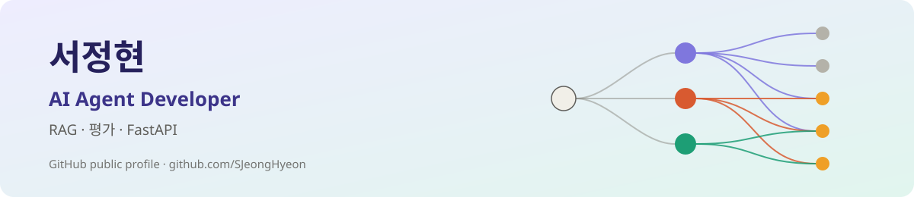

<picture>
  <source media="(prefers-color-scheme: dark)" srcset="assets/banner-dark.svg">
  
</picture>

<p align="center">
  <a href="https://ai-agent-portfolio-theta.vercel.app/"></a>
</p>

```text
~/about
profile   GitHub 공개 프로필
repos     저장소 3개 공개 · 핀 고정
focus     RAG · 평가 · FastAPI
approach  측정으로 검증, 한계도 기록
```

## 대표 프로젝트

세 프로젝트 모두 수료 과정의 팀 프로젝트이며 개발은 끝났습니다. 수치는 좋은 값과 반대 값, 표본과 조건을 함께 적었고 각 저장소의 결과표에서 근거 파일을 확인할 수 있습니다.

| 프로젝트 | 결과 | 한 줄 | 내 역할 · 상태 |
| --- | --- | --- | --- |
| [**CreditPulse**](https://github.com/SJeongHyeon/credit-pulse) | **정답 근거 인용 23/25 · 오답 근거 0/25**<br><sub>동결 평가셋 v2의 관련 25문항, 1회 실행(2026-11-12 UTC) · 같은 평가셋으로 실험을 골랐음 · [근거](https://github.com/SJeongHyeon/credit-pulse#측정-결과)</sub> | 기업여신 심사역이 DART 사업보고서에서 체크리스트 항목의 근거를 찾아 판정 초안을 받고, 승인한 것만 메모로 저장하는 RAG·LangGraph 에이전트 | LangGraph 에이전트와 평가<br><sub>커밋 203건, PR 65건(병합 62) · 코드·시연 영상 공개 · CI 통과(Actions, 2026-11-19)</sub> |
| [**말해봄 Mk.2**](https://github.com/SJeongHyeon/malhaebom-mk2) | **종합 자동 통과 57/90 · 형식(출력 계약) 90/90**<br><sub>합성 입력 30건 × 3회(2026-10-06) · 최신 운영 구성의 사람 평가는 없음 · [근거](https://github.com/SJeongHyeon/malhaebom-mk2#측정-결과)</sub> | 한국어 면접 답변을 녹음하면 말하기 방식을 분석하고 답변 근거를 바탕으로 코칭하는 서비스 | 모델 평가·검증 도구, 관측·CI, 사용자 화면<br><sub>커밋 89건, PR 39건 · 코드 공개(영상 없음) · CI 통과(Actions, 2026-11-19) · [팀 소개 사이트](https://nanocode00.github.io/malhaebom-showcase/)</sub> |
| [**보이스가드**](https://github.com/SJeongHyeon/voiceguard) | **팀 모델 평가 Recall 98.98% · 오탐률(FPR) 48.84%**<br><sub>499개 샘플, 독립 시험셋 확인 전 · 저장소 시험 146 통과·4 실패(팀 코드 포함, 사본 재실행) · [근거](https://github.com/SJeongHyeon/voiceguard#실험-결과)</sub> | 통화 녹음을 분석해 보이스피싱 의심 여부와 확인할 대화 구간을 알려 주는 서비스 | 백엔드(FastAPI), 비동기 작업·요청 제어, 모델 연동<br><sub>커밋 47건, PR 28건(병합 27) · 코드·시연 영상 공개 · 백엔드 배포는 현재 내려감 · CI 없음</sub> |

커밋·PR 수는 비공개 원본 저장소에서 2026-11-19에 센 값이며 기여의 크기를 뜻하지 않습니다. 팀 성과와 내 담당 범위는 각 저장소의 `CONTRIBUTIONS.md`에 나눠 적었습니다.

**시연 영상**: [CreditPulse](https://github.com/SJeongHyeon/credit-pulse/blob/main/docs/demo/creditpulse_demo.mp4) · [보이스가드 원본 녹화(직접 녹화, 소리 포함, Google Drive)](https://drive.google.com/file/d/1u3DY856VDEZkHz8jf1ajQzmT7vNgpgHn/view?usp=sharing) · [보이스가드(서비스 화면만)](https://github.com/SJeongHyeon/voiceguard/blob/main/docs/demo/voiceguard_demo.mp4)

## 사례 연구

결과가 좋지 않거나 원인을 모르는 경우도 같은 표에 적었습니다. 각 글은 한 쪽입니다.

- **미채택 · CreditPulse**: [목차 어휘 번역](https://github.com/SJeongHyeon/credit-pulse/blob/main/docs/case-studies/term-bridge-rejected.md). 첫 검색 Hit@10 20/23 → 22/23이지만 검색 p50 1.73초 → 4.00초로 사전 한도(+1.5초)를 넘어 미채택했습니다.
- **승격 보류 · 말해봄**: [Prompt v5 후보](https://github.com/SJeongHyeon/malhaebom-mk2/blob/main/docs/case-studies/prompt-v4-v5-candidate.md). 비용은 약 13.3% 줄었지만 종합 자동 통과가 22/30 → 20/30으로 줄어 승격을 보류했습니다.
- **임시 롤백 · 보이스가드**: [ONNX INT8 분류기](https://github.com/SJeongHyeon/voiceguard/blob/main/docs/case-studies/onnx-int8-rollback.md). 점수가 0.99 이상으로 포화되는 현상이 관찰돼 PyTorch로 되돌렸고, 원인은 확정하지 못했으며 비교 결과 기록도 없습니다.

## 프로젝트와 기술의 관계

<p align="center">
<picture>
  <source media="(prefers-color-scheme: dark)" srcset="assets/relation-graph-dark.svg">
  
</picture>
</p>

<sub>직접 그린 관계도이며([생성 스크립트](assets/make_relation_graph.py)) 실제로 쓴 기술만 넣었습니다. 실선은 근거를 확인한 관계, 점선은 구현이 아니라 검증 근거만 있는 관계입니다.</sub>

<details>
<summary><b>이 관계도의 근거</b></summary>

숫자는 비공개 원본의 PR 번호이며, 각 저장소의 `CONTRIBUTIONS.md`에서 내용을 확인할 수 있습니다.

| 기술 | CreditPulse | 말해봄 | 보이스가드 |
| --- | --- | --- | --- |
| FastAPI | 심사 API·로그인 | 응답 계약 검증 #113·#116(점선) | #11·#12·#13·#15·#16·#17·#18·#19·#27 |
| 평가·측정 | 평가셋·사전 등록·`EVAL_REPORT.md` | 평가 실행기 #14·#19·#43·#45 | 분류 평가 도구 #56 |
| pytest | 키 없이 1626 통과(사본 재실행) | Product CI에 pytest 추가 #145 | E2E #36, 요청 제어 #19, 평가 도구 #56 |
| CI | Actions 통과(2026-11-19, `596a670`) | Actions 통과(2026-11-19, `e00b408`) | 없음 |
| Langfuse | `backend/services/tracing.py` | 지연 계측 #107·#108 | — |
| LangGraph | `backend/graph/` | — | — |
| RAG 검색·리랭크 | `EVAL_REPORT.md` 3장 | — | — |
| MCP·n8n | — | #142·#44 | — |
| Whisper·KoELECTRA | — | — | #33·#34·#37 |

</details>

## 어떻게 일하나

- **미채택도 기록합니다.** CreditPulse의 [평가 리포트](https://github.com/SJeongHyeon/credit-pulse/blob/main/EVAL_REPORT.md)에는 제목에 미채택이 표기된 절이 22개(순수 미채택 19개, 일부 채택·보류 3개) 있습니다. 측정 전에 기준을 먼저 등록했고, 결과가 기준에 못 미치면 효과가 있어도 되돌렸습니다.
- **한계를 먼저 적습니다.** 표의 수치마다 표본 수, 조건, 사람 평가 여부를 함께 적었습니다.
- **재현할 수 있게 둡니다.** 세 저장소 모두 API 키 없이 돌리는 시험 결과와 명령을 README에 남겼습니다. CreditPulse와 말해봄은 GitHub Actions에서도 통과했고(2026-11-19 수동 실행), 보이스가드는 CI가 없어 시험 4건 실패의 원인을 기록했습니다.

<details>
<summary><b>프로젝트별 상세 기여</b></summary>

팀 프로젝트에서는 개인 기여와 검증 범위를 구분해 기록합니다. 비공개 원본의 PR은 번호만 각 저장소의 `CONTRIBUTIONS.md`([CreditPulse](https://github.com/SJeongHyeon/credit-pulse/blob/main/CONTRIBUTIONS.md) · [말해봄](https://github.com/SJeongHyeon/malhaebom-mk2/blob/main/CONTRIBUTIONS.md) · [보이스가드](https://github.com/SJeongHyeon/voiceguard/blob/main/CONTRIBUTIONS.md))에 적었습니다.

### CreditPulse · 팀 프로젝트

- **에이전트·승인:** 단일 에이전트와 Supervisor·검색·작성 서브에이전트 구성, 사람 승인 interrupt와 체크포인트 재개, 사용자 규칙 메모리를 구현했습니다.
- **검색·평가:** 평가셋과 계약, 리랭커 측정, 비관련 질문 거절, 인용·숫자 검증, 그래프 검색 실험(미채택 결과 포함)을 맡았습니다.
- **서비스:** 심사 API, 로그인·가입, 화면, 거절 시 참고 뉴스, 프롬프트 인젝션 방어를 구현했습니다.
- **근거 문서:** 시장 근거 문서를 정리했습니다.
- 결과는 팀의 결과이고, 정답 판정과 결과 검토는 다른 팀원이 맡은 부분이 있습니다.

### 말해봄 Mk.2 · 팀 프로젝트

- **모델 평가 도구:** 구조화 출력 평가 실행기, 동일 모델의 범용 응답·서비스 응답 비교 실행기, README 근거·공고 적합성 비교와 출력 검증을 구현했습니다.
- **출력 신뢰성:** JSON Schema 요청과 출력 절단 오류 분류를 보완하고, 모델·프롬프트 후보를 재평가했습니다. 자동 판정이 어긋난 사례를 사람이 검토할 양식과 사전 검사 도구를 추가했습니다.
- **판단 기준·Prompt:** 원인 판단을 관찰 신호와 추론 연결로 나누고, README·공고 분석 규칙의 버전 관리와 Prompt 구성을 정리했습니다.
- **관측·장애 검증:** Langfuse provider 호출의 시작·종료 및 지연 시간 계측을 수정했습니다. MCP 장애 응답, 코칭 결과의 DB 저장, 요청·응답 근거를 확인하는 검증 도구를 추가했습니다.
- **재현·자동화:** 새 복제본의 Docker Compose 실행과 로컬 E2E를 검증하고, pytest CI·배포 health/CORS 검사·n8n 모의 코칭 콜백 워크플로를 보강했습니다. Windows 인코딩·토큰 파일 처리 문제도 수정했습니다.
- **사용자 화면·전달:** 시작 화면과 연습 진입 버튼, 라이트/다크 테마 전환 및 상태별 일러스트를 추가하고 발표용 PPT를 제작했습니다.
- 평가·실험 도구와 운영 제품의 적용 범위는 구분합니다. 과거 평가와 일부 연결 검증은 현재 전체 서비스 품질을 보장하지 않습니다. PPT 제작을 담당했으며 발표는 담당하지 않았습니다.

### 보이스가드 · 팀 프로젝트

- **백엔드 API:** FastAPI API 계약, 파일 업로드 검증, 공통 오류 응답과 요청 추적, 모델 준비 상태 확인을 구현했습니다.
- **비동기 작업·보호 장치:** 작업 상태·결과 조회와 실제 실행 작업 취소, 임시 음성 자료 정리, 중복 작업 잠금·요청 제한·IP 해시 처리를 연결했습니다.
- **음성·분류 파이프라인:** Whisper/LoRA 및 KoELECTRA 실행 연동, 전사문 정규화, 음성·텍스트 청킹, 위험 점수·상위 구간 집계와 단계별 진행률을 구현했습니다. 청크 전사·분류를 큐로 연결하는 스트리밍 파이프라인도 추가했습니다.
- **실행 설정·문제 해결:** Docker 실행 설정, 음성 바이트 디코딩 수정, 분석 시간 제한을 맡았고, ONNX INT8 분류기를 도입했다가 점수 포화 현상이 관찰되어 PyTorch로 되돌렸습니다(원인은 확정하지 못함).
- **검증 도구:** 업로드부터 결과·실패·취소·정리까지의 E2E 테스트와 분류 평가 지표·혼동행렬을 산출하는 도구를 추가했습니다.
- 모델 학습 성과는 팀의 성과이며, 여기서는 제가 담당한 실행 연동·서비스 구현·검증 기여를 소개합니다.

### TicketPilot · 개인 프로젝트

Windows에서 예매 시작 시각을 KST 기준으로 관리하는 Python 데스크톱 도우미입니다.

- CustomTkinter GUI, 날짜·시간 선택, 카운트다운과 사전 알림, 설정 저장
- URL 검증, 예약 취소·중복 방지, 로컬 테스트 서버와 자동 테스트
- 실제 예매 사이트에서는 사용자가 직접 예매합니다. 자동 클릭 검증은 로컬 테스트 페이지에서만 수행합니다.
- Windows 실행 파일 빌드 구성과 사용자 설정 저장 위치 처리까지 구현했습니다.
- [공개용 코드 저장소](https://github.com/SJeongHyeon/ticketpilot-public)

</details>

## 기술

Python · FastAPI · LangGraph · RAG(하이브리드 검색·리랭크) · 평가(자체 평가셋, RAGAS) · Langfuse · Docker · PostgreSQL(pgvector)

<sub>마지막 갱신: 2026-11-19</sub>
